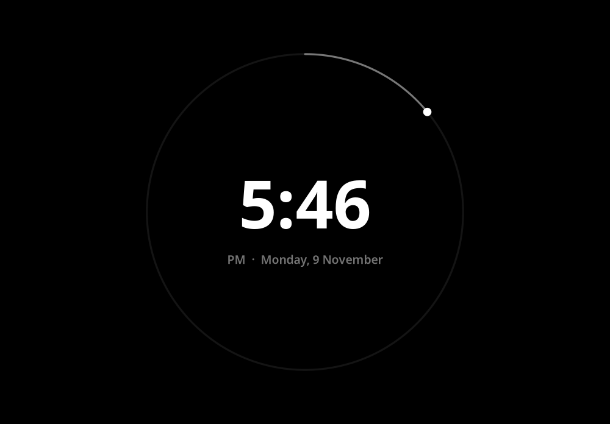

# lyrc

A fullscreen black screen showing synced lyrics for whatever is playing.
Works with Spotify, YouTube and YouTube Music in Chrome (any MPRIS2 player, really),
on Wayland and X11. Lyrics come from [LRCLIB](https://lrclib.net), with no API key.

- The command is `lyrics-overlay`. Run it to open lyrc. Run it again (or press **Esc** / **q**) to close it.
- Lyrics show **one word at a time** in big text. Press **l** to switch to line view
  (current line white, others dimmed, scrolling with the song).
  Most lyrics only have per-line timing, so word timing is estimated within each line.
- **↑ / ↓**: bigger / smaller text.
- **Shift+1 … Shift+9**: how many words to show at once in word view (default 1).
- **Double-tap Shift**: swap to black text on white (and back).
- **Shift+C**: full-screen clock instead of lyrics (and back). The screen stays awake while it's shown.
- Plain (untimed) lyrics scroll with **j/k**, **PgUp/PgDn**, **Space** or the mouse wheel.
- Size, words-at-once, view and colors are remembered in `~/.config/lyrics-overlay/settings.json`.
- Lyrics are cached in `~/.cache/lyrics-overlay/`.
- While music is playing, the screen won't dim or lock. Pausing gives normal idle back.
- There's no background process; it exits fully when closed.
- In `top` / System Monitor it shows up as **`lyrc`**.

## Screenshots

| Word view (default) | Shift+3: three words at a time |
|---|---|
|  |  |
| **Line view (`l`)** | **Light mode (double-tap Shift)** |
|  |  |
| **Clock (Shift+C)** | |
|  | |

<sub>Rendered by the app itself (with sample lyrics).</sub>

## Install

Requires Python 3, GTK 4 and PyGObject.

| Distro | Command |
|---|---|
| Fedora | `sudo dnf install python3-gobject gtk4` |
| Ubuntu / Debian | `sudo apt install python3-gi gir1.2-gtk-4.0` |
| Arch | `sudo pacman -S python-gobject gtk4` |

Then, from this folder:

```sh
./install.sh
```

This copies the app to `~/.local/share/lyrics-overlay` and links the command into
`~/.local/bin` (no root needed). Make sure `~/.local/bin` is in your `PATH`.
To uninstall, run `rm -rf ~/.local/share/lyrics-overlay ~/.local/bin/lyrics-overlay`.

## Keyboard shortcut

Use the full path, since shortcuts don't always see your shell's `PATH`:
`/home/YOU/.local/bin/lyrics-overlay`

**GNOME:** Settings → Keyboard → View and Customize Shortcuts → Custom Shortcuts → **+**.
Name: `Lyrics`, Command: the path above. Then set a shortcut, e.g. Super+Y.

Or from a terminal (sets **Super+Y**, keeps your other custom shortcuts):

```sh
K=org.gnome.settings-daemon.plugins.media-keys
B=/org/gnome/settings-daemon/plugins/media-keys/custom-keybindings/lyrics-overlay/
gsettings set $K.custom-keybinding:$B name 'Lyrics overlay'
gsettings set $K.custom-keybinding:$B command "$HOME/.local/bin/lyrics-overlay"
gsettings set $K.custom-keybinding:$B binding '<Super>y'
L=$(gsettings get $K custom-keybindings)
case "$L" in
  *"$B"*) ;;
  "@as []"|"[]") gsettings set $K custom-keybindings "['$B']" ;;
  *) gsettings set $K custom-keybindings "${L%]}, '$B']" ;;
esac
```

To use another key, change `'<Super>y'` (e.g. `'<Control><Alt>l'`). Avoid plain Ctrl+L,
since apps use it (browser address bar, clearing the terminal).

**KDE Plasma:** System Settings → Keyboard → Shortcuts → **Add New** → **Command or Script**.
Enter the path above, then assign a key.

## Troubleshooting

Run it from a terminal with debug output:

```sh
lyrics-overlay --debug
```

This prints the player in use, raw and cleaned artist/title, the lyrics source
(`cache`, `lrclib-get`, `lrclib-search`, `none`) and the sync position every 2 seconds.

- **"Waiting for a player…"**: check that your player shows up in
  `busctl --user list | grep mpris`.
- **Wrong song matched / lyrics out of sync**: delete the file for that song in
  `~/.cache/lyrics-overlay/` and reopen.
- **Chrome not detected**: make sure media keys / the media hub work in Chrome.
  That's the same MPRIS interface.

## Tests

```sh
python3 -m unittest discover tests
```
